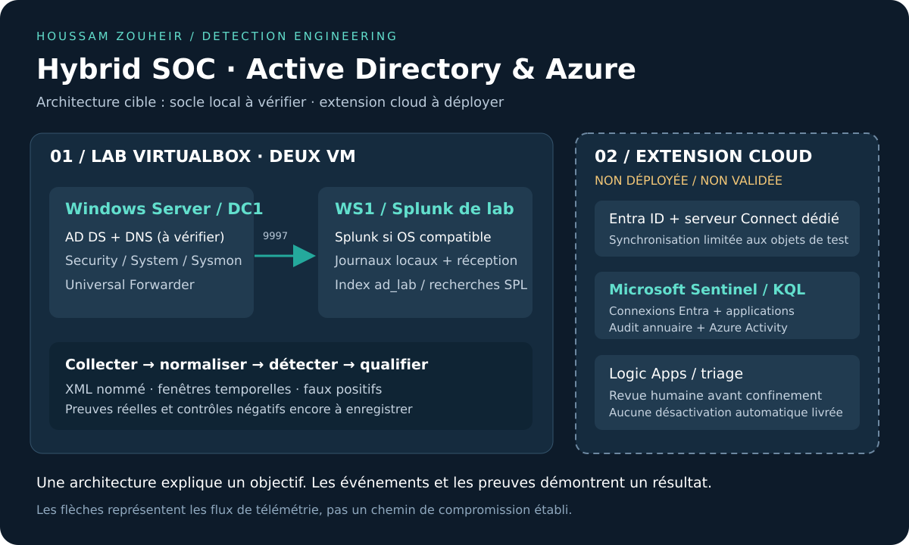

# Hybrid SOC · Active Directory & Azure

**Du journal Windows à une décision de triage : détection d'activités suspectes sur Active Directory et préparation d'une extension Microsoft Sentinel.**

Projet personnel de **Houssam Zouheir**, orienté **SOC / Blue Team / détection** et présenté dans le cadre d'une recherche de **stage PFE en cybersécurité**.



## Le projet en une minute

Le lab part de deux VM VirtualBox : **Windows Server** et **WS1**. Il propose un pipeline Windows Event Logs / Sysmon → Splunk, des recherches SPL documentées, puis une extension Entra ID / Sentinel avec des requêtes KQL distinctes pour les identités humaines, les applications et les rôles Azure.

L'objectif est de montrer un raisonnement analyste : **quel événement observe-t-on, quel comportement suggère-t-il, quels faux positifs faut-il éliminer et quelle preuve faut-il conserver ?**

- **12 recherches SPL** : baseline, authentifications, Kerberos, accès LSASS, réplication AD, services, tâches et groupes privilégiés.
- **4 recherches KQL** : connexions techniques, service principals, rôles Entra et Azure RBAC.
- **Configurations versionnées** : collecte Windows XML, réception Splunk et filtrage Sysmon.
- **Outils de préparation** : inventaire PowerShell en lecture seule, export des événements et normalisation XML indépendante de la langue Windows.
- **Réponse documentée** : workflow Logic Apps de triage sans confinement automatique et procédure de revue analyste.
- **Tests locaux** : traitement XML et contrôles de cohérence du dépôt, sans dépendance Python externe.

## État réel et preuves

**Le dépôt est un kit de lab reproductible ; il ne prétend pas que la chaîne AD → Azure est déjà validée de bout en bout.**

Les trois premières détections d'authentification étaient présentes dans l'historique du projet. Cette version les corrige et étend la couverture. Les VM Windows Server et WS1 sont disponibles d'après l'inventaire fourni ; l'état de leur domaine, de Splunk et des agents reste à confirmer par les contrôles du guide.

Les fichiers SPL/KQL sont **à valider dans les moteurs SIEM**. Les tests Python vérifient les outils et la structure du dépôt, pas l'exécution des requêtes dans Splunk ou Sentinel. L'extension Azure, la synchronisation, le graphe BloodHound et la démo vidéo restent à réaliser. Les données de `fixtures/` sont explicitement synthétiques.

Consulter le [registre des preuves](evidence/README.md) pour les critères de validation. Aucune capture d'alerte, statistique de performance ou compromission cloud n'est inventée.

## Explorer le projet

- [Démarrer avec Windows Server + WS1](docs/01-two-vm-lab.md)
- [Catalogue des détections, prérequis et faux positifs](docs/02-detection-catalog.md)
- [Plan de validation et protocole de démonstration](docs/03-validation.md)
- [Extension Entra ID / Microsoft Sentinel](docs/04-azure-extension.md)
- [Triage et réponse aux incidents](playbooks/README.md)
- [Durcissement et limites techniques](docs/05-hardening-and-lessons.md)
- [Références officielles](docs/references.md)

## Démarrage rapide

```bash
git clone https://github.com/houssam-ops/hybrid-soc-ad-azure-lab.git
cd hybrid-soc-ad-azure-lab
python3 -m unittest discover -s tests -v
```

Ces tests peuvent être lancés sur Linux, macOS ou Windows avec **Python 3.10+**. Le lab lui-même nécessite Windows Server pour AD DS, une édition Windows permettant l'usage prévu du domaine, une version de Splunk compatible avec l'OS choisi et les licences correspondantes.

Sur **chaque VM**, ouvrir PowerShell administrateur et lancer le diagnostic en lecture seule :

```powershell
.\scripts\Get-LabReadiness.ps1
```

Puis suivre le [guide deux VM](docs/01-two-vm-lab.md). Les scripts ne désactivent pas Defender, ne changent pas les politiques d'exécution et ne créent pas automatiquement de comptes privilégiés.

Pour essayer l'outil XML avec des **données synthétiques** :

```bash
python3 scripts/normalize_events.py fixtures/synthetic-events.xml --output artifacts/synthetic-normalized.json
```

Le dossier `artifacts/` est exclu de Git. Le normaliseur ne réalise ni détection ni anonymisation : il conserve les noms des champs XML et distingue notamment le compte initiateur du compte ciblé.

## Choix d'ingénierie

**Windows en français.** Les messages rendus peuvent produire des champs multivalués ou localisés. Les recherches privilégient les champs XML nommés et documentent les replis compatibles avec les anciennes extractions.

**Petit lab, seuils explicites.** Une recherche RDP doit être utile avec une seule station. Une demande de ticket RC4 peut justifier un triage, mais ne démontre pas à elle seule un Kerberoasting réussi.

**Identités hybrides.** Un compte AD synchronisé, un compte de synchronisation, un service principal et un rôle Azure ne sont pas interchangeables. Un chemin de compromission doit être démontré par les permissions effectives, pas dessiné comme acquis.

**Réponse proportionnée.** Le workflow livré prépare une revue. La désactivation d'un compte demande une identification correcte de l'acteur et de la cible ainsi qu'une approbation et un retour arrière.

## Structure

```text
configs/       Exemples Splunk et Sysmon pour le lab
detections/    Recherches SPL/KQL et catalogue JSON
diagrams/      Architecture cible et frontières de confiance
docs/          Installation, validation, cloud et durcissement
evidence/      Critères et modèle de preuves réelles
fixtures/      Événements synthétiques pour les tests
playbooks/     Workflow de triage et procédure de réponse
scripts/       Diagnostic, export et normalisation des événements
tests/         Tests locaux, sans affirmation de validation SIEM
```

## Périmètre et précautions

Lab isolé et comptes de test uniquement. Aucun déploiement Azure ni changement sur un tenant réel n'est exécuté par le dépôt. Examiner les licences et coûts avant d'activer les connecteurs cloud. Les budgets Azure sont des mécanismes d'alerte, pas une garantie d'arrêt de facturation.

Ne pas publier de secrets, exports complets de l'annuaire, dumps mémoire ou journaux non expurgés. Les fichiers sensibles courants sont exclus par `.gitignore` ; la revue humaine des captures reste indispensable.

## Auteur et objectif PFE

**Houssam Zouheir** — [GitHub](https://github.com/houssam-ops) · [Portfolio cybersécurité](https://github.com/houssam-ops/portfolio-cybersecurite)

Domaines ciblés : **SOC, Blue Team, détection, sécurité Active Directory et sécurité cloud**. Ce projet sert de support technique à une discussion sur la collecte, la qualité des données, la corrélation et les limites d'une détection.
